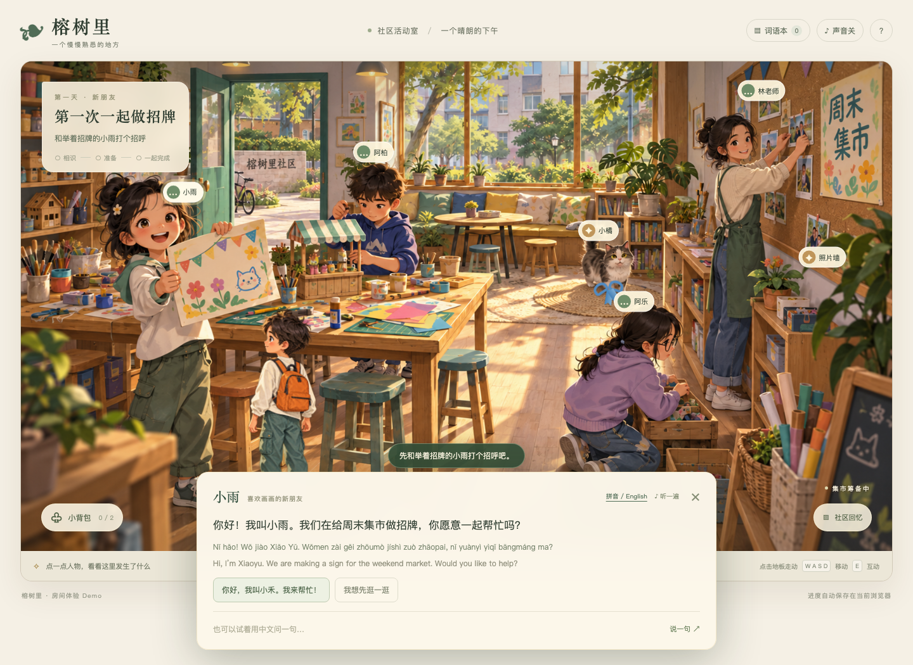

# ChineseGame 中文社区生活游戏

一个面向外国儿童与青少年的中文学习游戏开发起始项目。玩家搬进社区，通过认识朋友、参与活动和解决生活问题使用中文，逐渐留下共同经历。

这里收录产品规划、可行性报告、社区与室内地图、美术方向，以及第一段可完整体验的网页 Demo。资料整理于 **2026年10月16日**。

## 先体验 榕树里活动室

**[打开在线 Demo](https://rongshuli-activity-room.ningyuanyu8.chatgpt.site)** · **[查看 Demo 说明](demos/rongshuli-room/README.md)**

在线版本沿用现有站点的访问权限。本地运行不需要站点登录，建议优先用电脑体验。



你是刚搬来的小禾。社区正在准备周末集市：先认识小雨，问朋友找线索，从小猫那里取回蓝丝带，向阿乐借颜料，再选择颜色、图案和文字，完成大家的第一块招牌。

当前 Demo 已包含：

- 点击地板行走、WASD 或方向键移动、走近后互动。
- 四名人物、小猫和照片墙，以及任务完成前后的不同回应。
- 中文对话、可选拼音与英文提示、浏览器语音朗读。
- 材料收集、背包、词语本和招牌制作。
- 当前浏览器自动存档、继续游戏、共同回忆和重新开始。

NPC 目前使用预设分支与本地关键词识别；记忆是这个任务的规则状态。实时 AI、长期自主 Agent 社区和完整分龄课程属于后续规划。

## 本地运行

需要 **Node.js 20 或更新版本**。Demo 本身没有运行时第三方依赖，可以直接启动：

```bash
git clone git@github.com:7x-2026/chinesegame.git
cd chinesegame
npm run dev
```

打开 **http://127.0.0.1:8787**。使用 HTTPS 克隆也可以：`https://github.com/7x-2026/chinesegame.git`。

运行任务与存档测试：

```bash
npm test
```

需要浏览器完整流程检查时，先安装测试依赖和浏览器，在一个终端运行 Demo，再在另一个终端执行测试：

```bash
npm ci
npx playwright install chromium
npm run test:e2e
```

`test:e2e` 默认连接本地 8787 端口；可通过 `DEMO_URL` 指向其他本地预览地址。测试在新浏览器上下文中运行，不会清除日常浏览器的存档。

## 初始资料导航

| 资料 | 内容 |
| --- | --- |
| [资料总览与阅读顺序](docs/README.md) | 当前方向、历史资料和阅读入口 |
| [产品框架](docs/product/product-framework.md) | 定位、年龄分层、成长入口和故事结构 |
| [课程与事件设计](docs/product/learning-and-events.md) | 能力覆盖、复习、节奏、事件制作格式 |
| [NPC 与记忆](docs/product/npc-and-memory.md) | 人物阵容、关系、记忆和多 Agent 职责 |
| [技术与开发路线](docs/development/technical-plan.md) | 现有实现、架构边界和分阶段扩展 |
| [下一阶段工作](docs/development/roadmap.md) | 从当前 Demo 继续验证的事项 |
| [设计与可行性完整报告](docs/reports/社区生活式中文学习游戏设计与可行性报告.docx) | 可编辑 Word，另有 [PDF 阅读版](docs/reports/社区生活式中文学习游戏设计与可行性报告.pdf) |
| [社区与室内地图](docs/maps/README.md) | 可交互布局草案、静态预览与源片段 |
| [竞品研究](docs/research/README.md) | 2026年10月15日的报告、数据和来源 |
| [美术与素材来源](demos/rongshuli-room/ASSET_NOTES.md) | 概念图、最终素材与完整生成提示词 |

## 仓库结构

```text
chinesegame/
├── README.md
├── package.json
├── package-lock.json
├── demos/
│   └── rongshuli-room/
│       ├── dist/             # 可直接部署的页面、逻辑和游戏素材
│       ├── tests/            # 状态测试与浏览器流程检查
│       ├── server.mjs        # 本地静态服务
│       ├── README.md
│       └── ASSET_NOTES.md
└── docs/
    ├── product/              # 产品、课程、事件和角色框架
    ├── development/          # 技术路线与开发事项
    ├── maps/                 # 地图与室内分区
    ├── images/               # 概念图、地图与 Demo 预览
    ├── reports/              # 完整设计及可行性报告
    └── research/             # 竞品研究与来源
```

`demos/rongshuli-room/dist` 虽然名为 `dist`，目前存放手写网页源码和素材，是本 Demo 的实际开发入口；项目没有打包步骤。

## 当前方向与未定事项

长期目标为幼儿园至18岁，采用“同一个社区、按年龄进入不同故事阶段、中文水平独立调整”的框架。首轮教学验证建议收窄到一个年龄段和一种中文起点，尚未确定最终首发人群。

现有 Demo 验证的是单房间互动与故事闭环，不代表已覆盖一个年龄段的全部学习内容。后续重点是儿童试玩、能力目标与表现证据、更多事件、人物动画及受控 AI 对话。

原始临时研究、渲染缓存、旧测试产物和 Sites 专属发布配置未纳入此仓库。竞品资料保留调研日期，产品价格和功能应在后续决策前重新核验。
