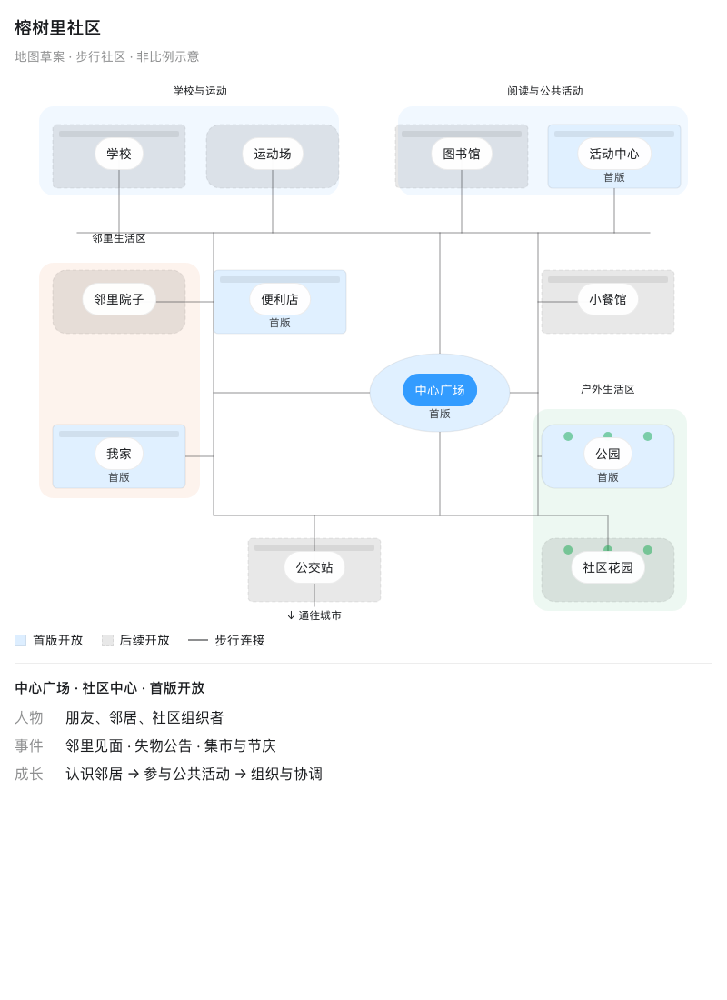

# 社区与室内地图

这些是地点和动线的规划草案，用于安排场景、事件和后续扩展。最终游戏美术以[活动室概念图](../images/activity-room-concept.png)和[可玩 Demo](../../demos/rongshuli-room/README.md)为参考。

## 社区

[打开可交互社区图](community-map.html) · [可编辑源片段](sources/community-map.fragment.html)

以中心广场连接生活环线。北侧为学校、运动场、图书馆和活动中心；西侧为我家与邻里院子；中部安排便利店与餐馆；东南侧为公园和社区花园；公交站预留对外故事入口。

首版规划先开放我家、便利店、广场、公园和活动中心。当前实际可玩范围只有活动室，不等同于规划图中全部地点已完成。

## 室内

[打开可切换建筑的室内图](community-interiors.html) · [可编辑源片段](sources/community-interiors.fragment.html)

| 建筑 | 分区 | 静态图 |
| --- | --- | --- |
| 我家 | 卧室、书房、客厅、餐厨区、洗漱间、玄关 | [住宅布局](../images/interior-home.png) |
| 便利店 | 冷藏区、备货间、货架区、收银区、入口区 | [便利店布局](../images/interior-store.png) |
| 活动中心 | 活动室、讨论室、器材间、门厅 | [活动中心布局](../images/interior-center.png) |

室内按“建筑 → 房间 → 互动物品”展开。先制作少量完整互动房间，同一布局通过物品、人物、年龄与事件变化继续使用。

## 如何查看

GitHub 直接打开 HTML 链接时可能展示源码或下载文件。可下载后在浏览器打开，或在仓库根目录运行 `python3 -m http.server 8790`，再访问 `http://127.0.0.1:8790/docs/maps/community-map.html`。

HTML 已包含独立展示外壳；`sources/` 保留原始片段以便修改。页面内的选中状态只用于查看布局，不代表真实游戏存档或角色能力。
